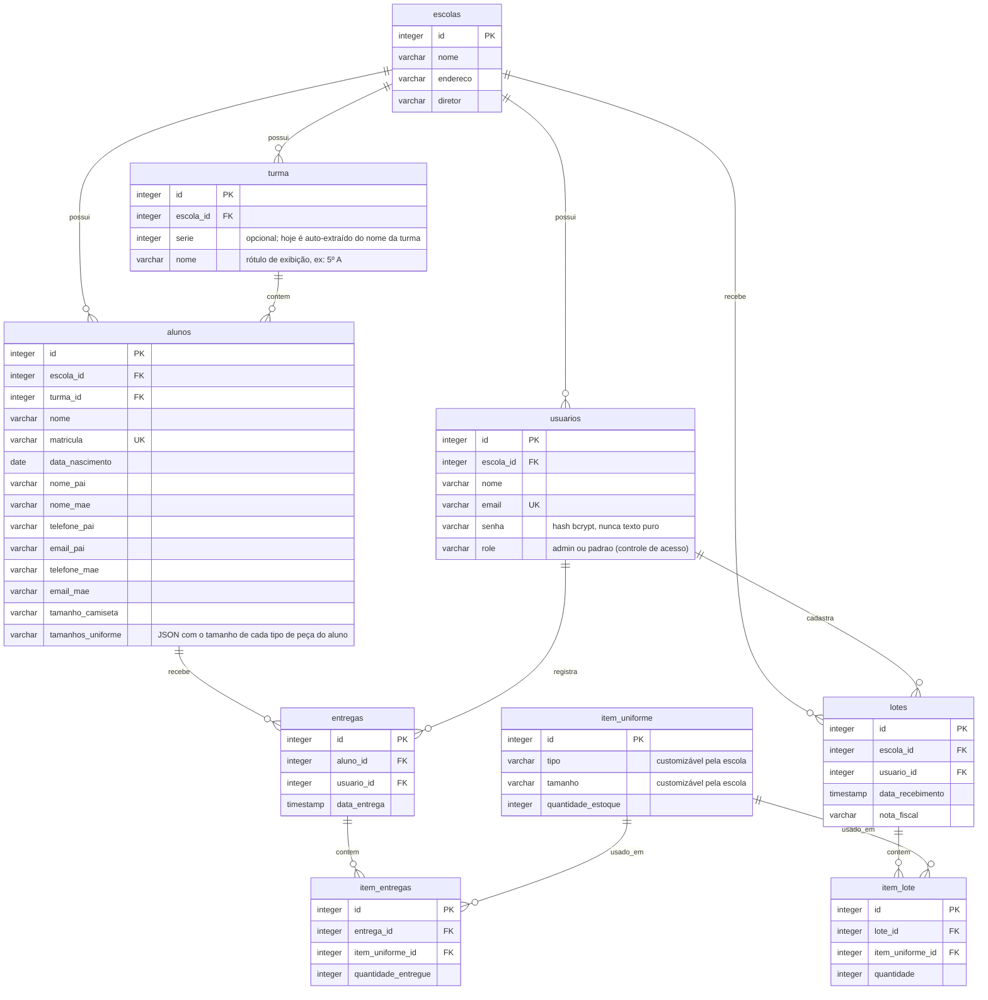

## Observações / decisões de modelagem

- **Modelo de escola única.** A tabela `escolas` continua existindo (e tecnicamente suporta
  mais de uma linha), mas o sistema hoje opera no modelo de **escola única**: a primeira
  escola é criada no assistente de configuração inicial (`POST /auth/setup-inicial`) e todo
  o resto do sistema usa esse `escola_id` automaticamente, sem seletor de escola nas telas.
- **`turma.nome` + `serie` opcional.** `nome` é o rótulo de exibição (ex: "5º A"), usado
  desde o início porque o ERD original só previa a série numérica. A coluna `serie` virou
  opcional e hoje é **extraída automaticamente** do nome da turma pelo backend, em vez de
  exigida no cadastro.
- **`alunos.situacao_uniforme` foi removida.** Na primeira versão esse era um campo
  editável e sincronizado a cada entrega. Isso causava inconsistência quando editado na mão
  sem bater com o histórico real. Hoje a situação ("Recebido"/"Pendente") é **sempre
  calculada dinamicamente** a partir das entregas registradas do aluno, nunca armazenada.
- **`alunos.tamanho_camiseta` e `alunos.tamanhos_uniforme`.** `tamanho_camiseta` continua
  como campo editável (uso rápido/legado). `tamanhos_uniforme` é um campo novo que guarda,
  em JSON, o tamanho de **cada tipo** de peça do aluno (não só camiseta) — necessário depois
  que o estoque passou a aceitar tipos de uniforme customizados pela escola.
- **Contato dos responsáveis.** `telefone_pai`, `email_pai`, `telefone_mae` e `email_mae`
  foram adicionados para permitir contato direto com a família a partir do cadastro do
  aluno.
- **`usuarios.role`.** Controla permissão básica (`admin` ou `padrao`) para ações
  restritas do sistema (controle de acesso / RBAC).
- **`item_uniforme` customizável.** As restrições fixas de tipo/tamanho (`chk_tipo`,
  `chk_tamanho`) foram removidas do banco. Qualquer escola pode cadastrar seus próprios
  tipos de peça (ex: "Meia", "Avental") e tamanhos, em vez de ficar limitada à lista
  original (Camiseta, Calça, Bermuda, Agasalho, Boina).
- **Login e auditoria não têm tabela própria no ERD.** A autenticação (`routers/auth.py`)
  valida contra a própria tabela `usuarios` (e-mail + hash bcrypt da senha) — não existe
  tabela de sessão. Os logs de auditoria (`routers/logs.py`) não ficam no banco relacional:
  são gravados diretamente em `logs/sistema_logs.txt`, um arquivo texto, para manter o
  registro simples e sempre disponível independente do banco.
- **`usuarios.senha`** guarda o hash bcrypt da senha, nunca o texto puro.
- **Diferença entre `entradas` (lotes) e `entregas`:** uma *entrada* é o recebimento de um
  lote de uniformes do governo/fornecedor (soma no estoque); uma *entrega* é a distribuição
  de peças do estoque para um aluno específico (debita o estoque). São conceitos e tabelas
  separados de propósito.
